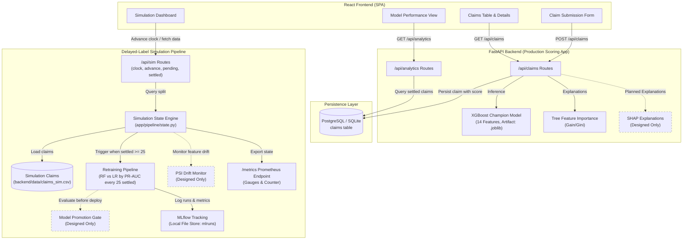

# ClaimGuard — Insurance Fraud Detection & Delayed-Label Simulation System

> An end-to-end MLOps platform for early insurance fraud risk detection that scores incoming claims in real time while addressing the real-world delayed-feedback loop where ground-truth fraud investigation outcomes arrive weeks or months later.

---

## Overview & The Problem

In real-world insurance underwriting and claims management, **ground-truth fraud labels are severely delayed**. When a claim is submitted, an insurer cannot know with certainty whether it is fraudulent; conclusive fraud determinations require field investigations, adjuster interviews, police reports, and legal proceedings taking anywhere from **10 to 30+ days** (or months).

Operating naively under this delayed feedback loop causes severe operational challenges:
1. **Intake Blindness**: Immediate claim approval without risk assessment invites massive financial exposure from undetected fraud.
2. **Delayed Learning**: Machine learning models cannot immediately train on claims filed today because the ground-truth target is unknown.
3. **Data Leakage & Evaluation Bias**: Evaluating models using naive splits or leaking future investigation outcomes introduces fatal optimism in production metrics.
4. **Distribution Shift**: Fraud tactics drift over time while investigation queues accumulate backlogs of unverified claims.

ClaimGuard solves this problem by separating the platform into two interconnected subsystems: an **immediate real-time scoring application** for intake adjudication and a **delayed-label simulation pipeline** for chronological retraining and MLOps observability.

---

## Two Parts of the System

| Subsystem Component | Description | Status in Code |
|---|---|---|
| **Part A: Production-Style Scoring App** | | |
| XGBoost Champion Model | High-throughput gradient boosted trees trained on 14 real-world automobile insurance claim features (`data/processed/carclaims_processed.csv`, 15,420 records). Loaded from serialized artifact (`data/models/xgb_champion.joblib`) in <10ms without training latency at startup. | **Done** |
| Post-hoc Tree Feature Importance | Feature importance explanations generated via tree gain/split metrics to identify high-risk drivers for adjusters. | **Done** |
| SHAP Explanations | Shapley Additive exPlanations for localized per-claim game-theoretic attribution. | **Future work** *(Designed only; not in codebase)* |
| Persistent Storage (PostgreSQL & SQLite) | Dual-backend persistence via SQLAlchemy 2 + psycopg 3 with connection pooling (`pool_pre_ping`). SQLite used for automated tests and isolated runs; PostgreSQL (Neon) used for persistent cloud environments. Stored predictions and feature explanations are immutable upon creation. | **Done** |
| REST API (`/api/claims`, `/api/analytics`) | Endpoints for claim submission, claim retrieval, manual ground-truth labeling (`PATCH /api/claims/{id}/label`), delayed settlement (`POST /api/claims/{id}/settle`), and dynamic performance metrics evaluated exclusively against labeled claims. | **Done** |
| Production Web Dashboard | React 18 + Tailwind CSS 4 user interface featuring interactive claim intake forms, circular risk score gauges, searchable claim tables, and confusion matrices. | **Done** |
| **Part B: Delayed-Label Simulation Pipeline** | | |
| Chronological Simulated Clock | Discrete event simulation advancing time step-by-step (default 7 days per step) across a historical timeline starting at `2015-01-01`. | **Done** |
| Settled vs. Pending Split | Strict separation of claims as of the simulated date: settled claims (`label_available_at <= as_of`) vs pending claims (`filed_at <= as_of < label_available_at`). Enforces strict contract: pending claims NEVER expose `is_fraud`, `investigation_days`, or `label_available_at`. | **Done** |
| Periodic Retraining Trigger | Retrains the simulation model automatically whenever $\ge 25$ newly settled claims accumulate since the last retrain. Compares Random Forest vs Logistic Regression on settled claims using PR-AUC, fitting the winning pipeline on all settled claims. | **Done** |
| Model Promotion Gate / Rule | Automated validation rule verifying a newly retrained candidate model outperforms the existing deployed model on held-out validation data before deployment. | **Designed only** *(Current code updates model unconditionally upon retrain)* |
| MLflow Experiment Tracking | Logging of retrain runs, hyperparameter tags, training cohort sizes (`n_train`, `n_pending`), and evaluation metrics (`precision`, `recall`, `f1`, `pr_auc`) to local file store (`mlruns/`). | **Done** |
| PSI Drift Detection | Population Stability Index (PSI) monitoring feature distribution shifts between settled training sets and pending claim backlogs (`drift.py`, `/api/sim/drift`). | **Future work** *(Designed only; not in codebase)* |
| Prometheus Observability (`/metrics`) | Export of simulation gauges (`claimguard_model_version`, `claimguard_settled_claims`, `claimguard_pending_backlog`, `claimguard_newly_settled_since_retrain`, `claimguard_last_retrain_pr_auc`, `claimguard_simulated_date_epoch`) and retrain counter (`claimguard_retrains_total`). | **Done** |
| Simulation UI Dashboard | Interactive React control panel for advancing the clock, visualizing pending backlogs, triggering retrains, and charting model evolution. | **Done** |

---

## System Architecture



---

## API Endpoints

The FastAPI backend exposes the following REST and metrics endpoints:

### Production Claims & Adjudication Routes (`/api/claims`, `/api/simulate`)

| Method | Path | Description |
|---|---|---|
| `POST` | `/api/claims` | Submit a new claim; runs XGBoost inference, generates explanations, assigns risk level (`low`, `medium`, `high`), persists to database with `status="pending"` and `true_label=None`. |
| `GET` | `/api/claims` | Retrieve all submitted claims ordered chronologically by submission date. |
| `GET` | `/api/claims/{claim_id}` | Retrieve single claim details by UUID. |
| `PATCH` | `/api/claims/{claim_id}/label` | Apply ground-truth investigation label (`true_label: bool`) to a pending claim. |
| `POST` | `/api/claims/{claim_id}/settle` | Settle a claim with outcome (`true_label: bool`), marking it `settled` while preserving original intake prediction and explanations. |
| `POST` | `/api/simulate/delayed-labels` | Bulk generate historical claims with simulated investigation labels for testing. |

### Analytics & Dev Routes (`/api/analytics`, `/api/seed`, `/api/dev`)

| Method | Path | Description |
|---|---|---|
| `GET` | `/api/analytics/stats` | Aggregated claim volume stats, risk distribution, pending vs settled counts, and fraud rate. |
| `GET` | `/api/analytics/model-performance` | On-the-fly model evaluation metrics (Accuracy, Precision, Recall, F1, ROC-AUC, 2×2 Confusion Matrix) evaluated exclusively on claims with `true_label IS NOT NULL`. |
| `POST` | `/api/seed` | Seed database with 20 realistic demo claims (7 legitimate, 7 fraud, 6 unlabeled). *Note: wipes existing claims.* |
| `POST` | `/api/dev/seed` | Alias for `/api/seed`. |

### Delayed-Label Simulation Routes (`/api/sim`)

| Method | Path | Description |
|---|---|---|
| `GET` | `/api/sim/clock` | Returns current simulated clock date (`{"simulated_date": "YYYY-MM-DD"}`). |
| `POST` | `/api/sim/advance` | Advances clock by specified `days` (default `{"days": 7}`). Automatically triggers retraining if $\ge 25$ settled claims accumulated. Returns `{"simulated_date", "newly_settled", "retrained", "model_version"}`. |
| `GET` | `/api/sim/pending` | Returns backlog of claims pending investigation as of `simulated_date`. Guaranteed by contract to exclude `is_fraud`, `investigation_days`, and `label_available_at`. |
| `GET` | `/api/sim/settled` | Returns all settled claims as of `simulated_date`, including `is_fraud` and `label_available_at`. |
| `GET` | `/api/sim/metrics` | Returns latest retraining metrics (`model_version`, `status`, `as_of`, `n_train`, `precision`, `recall`, `f1`, `pr_auc`). |

### System & Telemetry Routes

| Method | Path | Description |
|---|---|---|
| `GET` | `/` | API health check and root welcome payload. |
| `GET` | `/metrics` | Prometheus exposition format metrics exposing simulation gauges and retraining counters. |

---

## How to Run Locally

### Prerequisites
- **Python 3.11+** (Python 3.11 used in CI)
- **Node.js 20+** & `npm`

### 1. Backend Setup

#### Windows (PowerShell)
```powershell
# Navigate to backend directory
cd backend

# Create and activate virtual environment
python -m venv .venv
.venv\Scripts\Activate.ps1

# Install backend dependencies
pip install -r requirements.txt pytest httpx

# Pre-train and serialize the XGBoost champion model artifact (creates data/models/xgb_champion.joblib)
$env:PYTHONPATH="."
python -c "from app.ml.train_comparison import train_and_save_champion; train_and_save_champion()"

# Initialize database schema (SQLite by default)
$env:DATABASE_URL="sqlite:///./claims.db"
python -c "from app.database import init_db; init_db()"

# Launch backend server with auto-reload (runs at http://localhost:8000)
python run.py
```

*Alternatively, from the repository root:*
```powershell
$env:PYTHONPATH="backend"
$env:DATABASE_URL="sqlite:///./claims.db"
python backend/run.py
```

#### Unix / macOS (bash / zsh)
```bash
# Navigate to backend directory
cd backend

# Create and activate virtual environment
python3 -m venv .venv
source .venv/bin/activate

# Install backend dependencies
pip install -r requirements.txt pytest httpx

# Pre-train and serialize the XGBoost champion model artifact (creates data/models/xgb_champion.joblib)
PYTHONPATH=. python -c "from app.ml.train_comparison import train_and_save_champion; train_and_save_champion()"

# Initialize database schema (SQLite by default)
export DATABASE_URL="sqlite:///./claims.db"
python -c "from app.database import init_db; init_db()"

# Launch backend server with auto-reload (runs at http://localhost:8000)
python run.py
```

*Alternatively, from the repository root:*
```bash
PYTHONPATH=backend DATABASE_URL="sqlite:///./claims.db" python backend/run.py
```

### 2. Frontend Setup

In a separate terminal:

#### Windows (PowerShell) & Unix / macOS
```bash
cd frontend

# Clean install of npm packages matching package-lock.json
npm ci

# Start Vite development server (runs at http://localhost:5173)
npm run dev
```

### 3. MLflow Tracking UI

To inspect logged retraining runs, hyperparameter metrics, and model versions from the delayed-label simulation:

#### Windows (PowerShell)
```powershell
# From repository root
mlflow ui --backend-store-uri mlruns --port 5000
```

#### Unix / macOS
```bash
# From repository root
mlflow ui --backend-store-uri mlruns --port 5000
```
*Open http://localhost:5000 to view experiment `ClaimGuard_Simulation`.*

---

## Run with Docker

ClaimGuard includes a production `backend/Dockerfile` that automatically pre-trains and validates the XGBoost champion model during image build, packaging a self-contained container with persistent volume mounts for SQLite.

Detailed containerized instructions, volume binding, and multi-service deployment:
- See [docs/DOCKER.md](docs/DOCKER.md) *(TODO: docs/DOCKER.md)*

```bash
# Build production backend image
docker build -t claimguard-backend -f backend/Dockerfile .

# Run container with persistent data volume
docker run -d -p 8000:8000 -v claimguard_data:/data claimguard-backend

# TODO: Docker Compose full-stack startup (docker compose up -d) pending compose configuration
```

---

## Testing

The project maintains test coverage across backend units, database persistence, ML serving, simulation pipeline mechanics, and Prometheus metrics.

### Verification Commands

#### 1. Backend Simulation & Route Tests
Windows (PowerShell):
```powershell
$env:PYTHONPATH="backend"
pytest backend/tests
```
Unix / macOS:
```bash
PYTHONPATH=backend pytest backend/tests
```
*Result: **45 passed** in `backend/tests`.*

#### 2. Root Integration & Persistence Tests
Windows (PowerShell):
```powershell
$env:PYTHONPATH="backend"
pytest tests
```
Unix / macOS:
```bash
PYTHONPATH=backend pytest tests
```
*Result: **68 passed** in `tests`.*

#### 3. Frontend Production Build
```bash
cd frontend
npm run build
```
*Result: Vite build compiles 2,355 modules successfully to `frontend/dist/`.*

Total automated test count: **113 passing tests**.

---

## Model Benchmark Results

Models were benchmarked on the 14-feature automobile insurance claim dataset (`data/processed/carclaims_processed.csv`, 15,420 claims, 6% fraud prevalence) using a stratified 80/20 train/test split. Due to severe class imbalance, **PR-AUC (Precision-Recall Area Under Curve)** was the primary selection criterion.

Results output to `data/processed/model_comparison.csv`:

| Model | PR-AUC | ROC-AUC | Best F1 | Optimal Threshold | Precision | Recall |
|---|---|---|---|---|---|---|
| **XGBoost (Champion)** | **0.1872** | **0.7913** | **0.2267** | **0.40** | **0.1297** | **0.9027** |
| Random Forest | 0.1769 | 0.7971 | 0.2331 | 0.60 | 0.1351 | 0.8486 |
| Logistic Regression | 0.1281 | 0.7634 | 0.2128 | 0.40 | 0.1199 | 0.9459 |

Detailed benchmark documentation and threshold evaluations:
- See [docs/RESULTS.md](docs/RESULTS.md) *(TODO: docs/RESULTS.md)*
- *TODO: Final production dry-run latency and throughput table.*

---

## Status of MLOps Components

| MLOps Component | Status | Notes |
|---|---|---|
| **Claim Ingestion REST API** | **Done** | FastAPI endpoints with Pydantic v2 validation |
| **Real Automobile Claims Dataset (14 Features)** | **Done** | `data/processed/carclaims_processed.csv` (15,420 rows) |
| **Offline Model Benchmark & Comparison** | **Done** | `backend/app/ml/train_comparison.py` |
| **Champion Model Artifact Serving** | **Done** | Serialized `.joblib` loaded at startup (<10ms) |
| **Tree Feature Importance Explanations** | **Done** | Gain/Gini split-based directional attribution |
| **SHAP Local Attribution** | **Future work** | Designed only; not currently installed or in codebase |
| **Database Persistence (PostgreSQL & SQLite)** | **Done** | SQLAlchemy 2, psycopg 3, Neon cloud support |
| **Delayed-Label Intake & Settle Flow** | **Done** | `PATCH /label`, `POST /settle` preserving original predictions |
| **Chronological Simulation Clock & Step Engine** | **Done** | `app/pipeline/state.py` starting at `2015-01-01` |
| **Settled vs. Pending Split (Contract S1/S2)** | **Done** | Pending claims strictly omit labels & investigation window |
| **Automated Retraining (Settled $\ge 25$)** | **Done** | Compares RF vs LR by PR-AUC every 25 settled claims |
| **Model Promotion Gate / Rule** | **Designed only** | New model updates active pipeline unconditionally |
| **MLflow Experiment Tracking** | **Done** | Logs parameters, metrics, run IDs to local `mlruns/` |
| **Prometheus Exporter (`/metrics`)** | **Done** | 6 gauges and 1 counter in official exposition format |
| **Population Stability Index (PSI) Drift Check** | **Designed only** | `drift.py` and `/api/sim/drift` planned for future release |
| **Production Dockerfile** | **Done** | `backend/Dockerfile` with model pre-training step |
| **Docker Compose Multi-Container Orchestration** | **Designed only** | TODO: docs/DOCKER.md |
| **GitHub Actions CI Workflow** | **Done** | `.github/workflows/ci.yml` (backend tests & frontend build) |
| **Workflow Orchestration (Airflow)** | **Future work** | Designed only; not yet integrated |
| **Data & Artifact Versioning (DVC)** | **Future work** | Designed only; data tracked via Git/processed CSVs |
| **Production Authentication & RBAC** | **Future work** | Unauthenticated MVP endpoints |

---

## Known Limitations

1. **Two Separate Datasets and Models**: The production scoring application uses a 14-feature real automobile claims dataset (`data/processed/carclaims_processed.csv`) with an XGBoost champion. The simulation chronological replay pipeline uses a 13-feature synthetic claims dataset (`backend/data/claims_sim.csv`) with Random Forest / Logistic Regression retraining.
2. **Simulated Delays**: Investigation windows in the simulation dataset are generated synthetically using a fixed uniform window (10–30 days, seed 42) rather than reflecting real-world institutional delays.
3. **Small Simulation Dataset**: The simulation dataset contains 1,000 historical records, designed for demonstration and test verification.
4. **Advisory / Unimplemented Drift Monitoring**: PSI drift calculation (`drift.py`) is not yet implemented in the codebase.
5. **No Model Promotion Gate**: In the simulation pipeline, whenever 25 settled claims accumulate, the winner between Random Forest and Logistic Regression unconditionally replaces the active model version without checking against the existing champion.
6. **No Authentication or RBAC**: API endpoints do not require authorization tokens or distinct Adjuster vs Analyst credentials.
7. **In-Memory Simulation State**: Simulation state (`state.py`) resides in memory and resets across application restarts.
8. **Dev Seed Behavior**: The development seed endpoints (`POST /api/seed`, `POST /api/dev/seed`) clear existing claims before populating test data.
