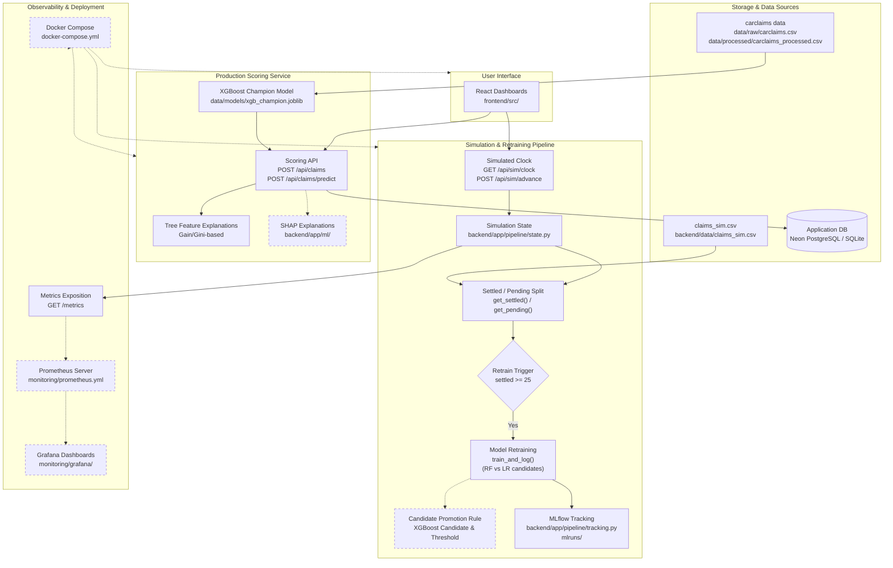
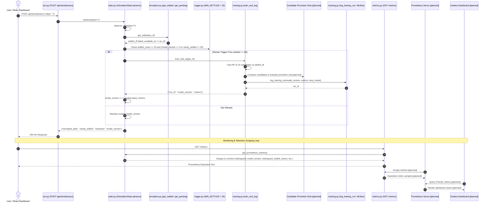

# ClaimGuard Architecture & System Design

This document details the architectural layout, simulation demo lifecycle, and core design decisions of ClaimGuard.

---

## 1. System Architecture Flowchart

**Legend**: Solid boxes = built components; Dashed boxes = designed only (planned).

---

## 2. Simulation Demo Sequence Diagram

The following sequence diagram outlines the end-to-end execution flow during a simulation clock advance: advancing the clock, settling claims past their investigation window, triggering model retraining at threshold, logging runs to MLflow, and exposing metrics for monitoring.

---

## 3. Design Decisions

### Why Simulated Delays
In real-world automobile insurance, fraud ground-truth is never known at the initial moment of filing; claims require an investigation window before an adjuster confirms or denies fraud. As defined in `backend/app/pipeline/prepare_data.py` (lines 79–82) and `docs/CONTRACT.md` (line 12), ClaimGuard simulates an investigation duration of 10 to 30 days (`label_available_at = filed_at + investigation_days`). This prevents target label leakage by ensuring pending claims strictly conceal `is_fraud`, `investigation_days`, and `label_available_at` while under active review.

### Why No Model Before 25 Settled Claims
As declared in `backend/app/pipeline/state.py` (lines 20, 103–105) and `docs/CONTRACT.md` (line 13), `MIN_SETTLED = 25` acts as an absolute guardrail before the initial retrain. Fitting models on fewer than 25 settled claims risks degenerate training folds where positive fraud instances are completely absent during validation splits (`_split_settled_data` in `backend/app/pipeline/training.py`). Waiting for at least 25 settled claims establishes the minimal statistical support required to train and cross-evaluate baseline estimators reliably.

### Why PR-AUC
Automobile insurance fraud is inherently class-imbalanced, with fraudulent claims representing a small fraction of total submissions. As implemented in `backend/app/pipeline/training.py` (lines 141, 147, 150) and required by `docs/CONTRACT.md` (line 21), model selection relies on Precision-Recall AUC (`average_precision_score`). Unlike ROC-AUC, which can appear artificially optimistic due to large counts of true negatives, PR-AUC focuses specifically on precision and recall over the minority fraud class.

### Why Two Separate Parts of the System
The production scoring application (`backend/app/routes/claims.py`, `backend/app/ml/pipeline.py`) provides fast synchronous inference backed by a pre-trained XGBoost champion (`data/models/xgb_champion.joblib`) evaluated across 14 processed features (`data/processed/carclaims_processed.csv`). Conversely, the simulation pipeline (`backend/app/routes/sim.py`, `backend/app/pipeline/`) models temporal dynamics, delayed ground-truth arrival, and periodic retraining on 13 simulation features (`backend/data/claims_sim.csv`). Isolating the simulation pipeline prevents synthetic clock manipulations and batch retraining runs from interfering with or corrupting real-time transactional scoring data.
