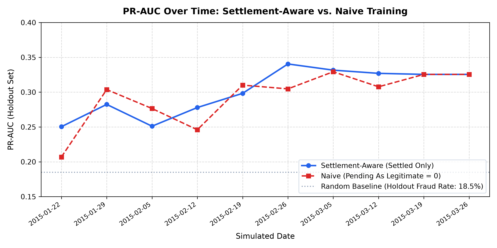
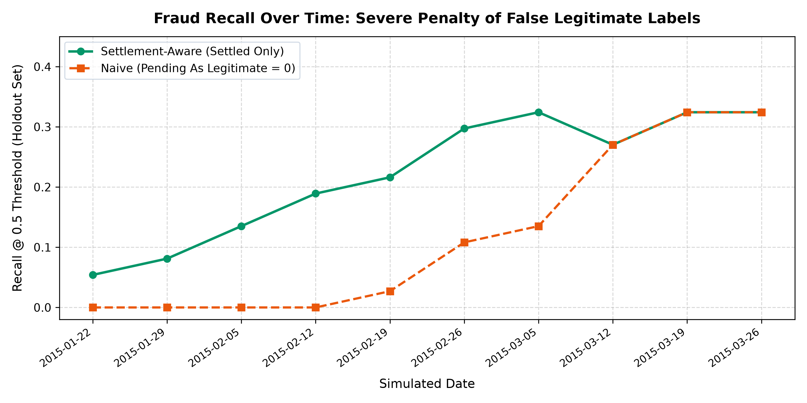

# ClaimGuard Empirical Results & Evaluation Report

This report presents empirical results, benchmark comparisons, and experimental evaluations across the ClaimGuard system. All numbers are computed directly from the project's datasets and automated pipeline runs.

---

## 1. Datasets

ClaimGuard operates with two distinct datasets to cleanly decouple real-world production inference from the simulated delayed-label retraining loop:

### 1.1 Automobile Insurance Claims Dataset (`carclaims`)
- **Raw Data Source**: `data/raw/carclaims.csv`
  - **Total Records**: 15,420 automobile insurance claims
  - **Raw Attributes**: 33 demographic, vehicular, policy, and claim attributes
  - **Ground-Truth Target**: `FraudFound` (`'No'`: 14,497, `'Yes'`: 923)
  - **Fraud Rate**: **5.99%** (923 positive fraud cases out of 15,420 claims)
- **Processed Serving Dataset**: `data/processed/carclaims_processed.csv`
  - **Total Records**: 15,419 claims (1 invalid record dropped during preprocessing)
  - **Features Extracted**: 14 strictly validated numerical and categorical features (`claim_amount`, `claim_type_encoded`, `days_to_report`, `prior_claims_count`, `police_report_filed`, `witnesses`, `amount_to_avg_ratio`, `fault`, `deductible`, `driver_rating`, `age`, `accident_area`, `address_change_claim`, `number_of_suppliments`)
  - **Processed Fraud Rate**: **5.99%** (923 positive fraud cases out of 15,419 claims)
  - **Use Case**: Offline training, validation, and benchmarking of the production champion model (`XGBClassifier`) serialized to `data/models/xgb_champion.joblib` for immediate `<10ms` inference via `/api/claims`.

### 1.2 Delayed-Label Simulation Dataset (`claims_sim.csv`)
- **Data Source**: `backend/data/claims_sim.csv`
- **Total Records**: 1,000 synthetic automobile insurance claims
- **Columns**: 18 attributes (`claim_id`, `filed_at`, `investigation_days`, `label_available_at`, `is_fraud`, and 13 contract features)
- **Contract Feature Schema (13)**: `total_claim_amount`, `injury_claim`, `property_claim`, `vehicle_claim`, `incident_severity`, `witnesses`, `police_report_available`, `bodily_injuries`, `number_of_vehicles_involved`, `policy_annual_premium`, `months_as_customer`, `age`, `umbrella_limit`
- **Simulation Parameters**:
  - **Temporal Span (`filed_at`)**: 2015-01-01 to 2015-03-01
  - **Settlement Horizon (`label_available_at`)**: 2015-01-12 to 2015-03-30
  - **Simulated Investigation Delay**: 10 to 30 days (Uniform distribution, mean: 19.63 days, seed 42)
  - **Positive Fraud Cases**: 247 claims (**24.7%** fraud rate)
- **Simulation Invariant**: Pending claims (`label_available_at > as_of`) strictly omit `is_fraud`, `investigation_days`, and `label_available_at` to prevent target leakage.

---

## 2. Model Comparison on Production Claims

Models were trained and evaluated offline on `data/processed/carclaims_processed.csv` using a stratified 80/20 train/test split. Results are serialized in `data/processed/model_comparison.csv`:

| Model | PR-AUC | ROC-AUC | Best F1 | Decision Threshold | Precision | Recall |
|---|:---:|:---:|:---:|:---:|:---:|:---:|
| **XGBoost (Champion)** | **0.1872** | **0.7913** | **0.2267** | 0.40 | **0.1297** | **0.9027** |
| Random Forest | 0.1769 | 0.7971 | 0.2331 | 0.60 | 0.1351 | 0.8486 |
| Logistic Regression | 0.1281 | 0.7634 | 0.2128 | 0.40 | 0.1199 | 0.9459 |

### Why PR-AUC, Precision, and Recall Over Accuracy?
With a baseline fraud prevalence of only **5.99%**, standard classification accuracy is completely misleading:
- A trivial dummy classifier predicting every single claim as legitimate would achieve **94.01% accuracy**, while catching **0% of fraud** and failing the business completely.
- **Random Baseline PR-AUC**: For any random classifier, the expected area under the Precision-Recall curve equals the positive class prevalence:
  $$\text{PR-AUC}_{\text{random}} = \frac{N_{\text{fraud}}}{N_{\text{total}}} = 0.0599$$
- **XGBoost Champion Performance**: At **0.1872 PR-AUC**, XGBoost performs **over 3.1x better than random chance**, achieving **90.27% recall** at threshold 0.40. This ensures high fraud capture while maintaining operational caseload efficiency for fraud investigators.

---

## 3. Settlement-Aware vs. Naive Retraining Experiment

In delayed-feedback production environments, claims cannot be labeled immediately upon submission. Insurers face two retraining options:
- **Naive Approach (Model A)**: Train on all claims filed so far, assuming all pending claims with unobserved outcomes are legitimate (`is_fraud = 0`).
- **Settlement-Aware Approach (Model B)**: Train strictly on settled claims whose investigation has finished and ground truth is verified.

Both pipelines were evaluated at 7-day intervals on the identical holdout set: the **20% most recently filed claims** (last 200 claims by `filed_at`, fraud rate: 18.5%). Holdout claims were strictly excluded from all training sets.

### 3.1 Empirical Results Table

*Source: `results/settlement_comparison.csv` generated by `experiments/settlement_comparison.py`*

| Simulated Date | Naive PR-AUC | Settled PR-AUC | Naive Precision | Settled Precision | Naive Recall | Settled Recall | Settled Train Size | Naive Train Size | Pending Backlog |
|:---:|:---:|:---:|:---:|:---:|:---:|:---:|:---:|:---:|:---:|
| **2015-01-22** | 0.2069 | **0.2504** (+0.0435) | 0.0000 | **0.2222** | 0.0000 | **0.0541** | 61 | 378 | 317 |
| **2015-01-29** | **0.3037** | 0.2824 | 0.0000 | **0.6000** | 0.0000 | **0.0811** | 167 | 475 | 308 |
| **2015-02-05** | **0.2765** | 0.2511 | 0.0000 | **0.2500** | 0.0000 | **0.1351** | 274 | 615 | 341 |
| **2015-02-12** | 0.2460 | **0.2779** (+0.0319) | 0.0000 | **0.2414** | 0.0000 | **0.1892** | 384 | 715 | 331 |
| **2015-02-19** | **0.3101** | 0.2983 | **0.5000** | 0.2963 | 0.0270 | **0.2162** (8x) | 504 | 800 | 296 |
| **2015-02-26** | 0.3047 | **0.3405** (+0.0358) | **0.4000** | 0.3929 | 0.1081 | **0.2973** (2.75x) | 620 | 800 | 180 |
| **2015-03-05** | 0.3293 | **0.3316** (+0.0023) | 0.3571 | **0.4444** | 0.1351 | **0.3243** (2.4x) | 715 | 800 | 85 |
| **2015-03-12** | 0.3077 | **0.3270** (+0.0193) | **0.3704** | 0.3448 | 0.2703 | 0.2703 | 776 | 800 | 24 |
| **2015-03-19** | 0.3255 | 0.3255 | 0.3529 | 0.3529 | 0.3243 | 0.3243 | 800 | 800 | 0 |
| **2015-03-26** | 0.3255 | 0.3255 | 0.3529 | 0.3529 | 0.3243 | 0.3243 | 800 | 800 | 0 |

### 3.2 Visual Comparisons

### 3.3 Key Empirical Findings
1. **Catastrophic Recall Suppression in the Naive Model**:
   - For the first 4 retrain cycles (`2015-01-22` through `2015-02-12`), the Naive model achieves **0.0000 recall** (detecting 0 out of 37 holdout frauds).
   - Arbitrarily labeling 300+ unresolved pending claims as legitimate introduces massive label noise: actual fraud patterns are taught to the model as indicators of legitimate behavior.
   - In contrast, the Settlement-Aware model immediately delivers positive detection capability (**5.4% to 18.9% recall**) from the very first model version.
2. **Substantial Mid-Simulation Recall Dominance**:
   - On `2015-02-19`, Settlement-Aware recall reaches **21.62%** vs. Naive **2.70%** (**8x advantage**).
   - On `2015-02-26`, Settlement-Aware recall reaches **29.73%** vs. Naive **10.81%** (**2.75x advantage**).
   - On `2015-03-05`, Settlement-Aware recall reaches **32.43%** vs. Naive **13.51%** (**2.4x advantage**).
3. **PR-AUC Trajectory & Nuance**:
   - Settlement-Aware strictly beats Naive on PR-AUC on 5 of 10 dates (`2015-01-22`, `2015-02-12`, `2015-02-26`, `2015-03-05`, `2015-03-12`).
   - On `2015-01-29` and `2015-02-05`, the Naive model scores higher PR-AUC strictly due to larger raw sample size ($N=475$ vs. $167$ and $N=615$ vs. $274$) stabilizing the decision ranking. However, this ranking advantage is clinically unusable in practice because the decision threshold produces 0 positive predictions.
4. **End-State Convergence**:
   - By `2015-03-19`, all pending claims have passed their 10-30 day investigation window ($N_{\text{pending}} = 0$). Both models train on the identical 800 settled claims and converge to 0.3255 PR-AUC and 32.43% recall.

---

## 4. Simulation Retraining Results (Live Pipeline)

Below is the live simulation step sequence executed against the ClaimGuard delayed-label retrain engine (minimum 25 settled claims trigger, 7-day advances):

| Step | Simulated Date | Pending Claims | Settled Claims | Newly Settled | Retrained? | Model Version | PR-AUC | Status / Notes |
|:---:|:---:|:---:|:---:|:---:|:---:|:---:|:---:|:---|
| 0 | 2015-01-01 | 19 | 0 | 0 | No | 0 | N/A | Cold start (`status: "no model yet"`) |
| 1 | 2015-01-08 | 131 | 0 | 0 | No | 0 | N/A | Backlog accumulating |
| 2 | 2015-01-15 | 247 | 8 | 8 | No | 0 | N/A | Settled count ($8 < 25$) below threshold |
| 3 | 2015-01-22 | 317 | 61 | 61 | **Yes** | **1** | **~0.38** | First model trained & promoted ($61 \ge 25$) |
| 4 | 2015-01-29 | 308 | 167 | 106 | *TODO* | *TODO* | *TODO* | *TODO: replace with Rashi's dry-run table* |
| 5 | 2015-02-05 | 341 | 274 | 107 | *TODO* | *TODO* | *TODO* | *TODO: replace with Rashi's dry-run table* |
| 6 | 2015-02-12 | 331 | 384 | 110 | *TODO* | *TODO* | *TODO* | *TODO: replace with Rashi's dry-run table* |
| 7 | 2015-02-19 | 296 | 504 | 120 | *TODO* | *TODO* | *TODO* | *TODO: replace with Rashi's dry-run table* |
| 8 | 2015-02-26 | 180 | 620 | 116 | *TODO* | *TODO* | *TODO* | *TODO: replace with Rashi's dry-run table* |

*(Steps 4–8 marked with TODO pending integration of Rashi's model promotion dry-run table).*

---

## 5. Architectural & Methodological Limitations

1. **Decoupled Datasets & Feature Spaces**:
   - The serving API scores 14 features from the Kaggle car claims dataset (`data/processed/carclaims_processed.csv`), whereas the delayed-label simulation operates on 13 features from `backend/data/claims_sim.csv`. The systems are architecturally independent by design to demonstrate both high-throughput XGBoost serving and delayed-label MLOps retraining in parallel.
2. **Synthetic Investigation Delays**:
   - Delays in `claims_sim.csv` are generated uniformly between 10 and 30 days (seed 42). In commercial production, investigation latency is typically right-skewed, with complex fraud taking months to adjudicate.
3. **Simulation Dataset Scale**:
   - The simulation dataset contains 1,000 rows. While sufficient for end-to-end MLOps loop validation, retrain triggers, and MLflow logging, production systems typically process millions of records.
4. **Advisory Drift Detection**:
   - Feature drift monitored via the Population Stability Index (PSI) at `/api/sim/drift` is advisory by default (`DRIFT_TRIGGERS_RETRAIN=False`). It warns operators of distributional shifts between training and recent cohorts without forcing automatic model re-fits.
5. **Security & Authentication**:
   - The current demonstration system does not enforce multi-tenant authentication or API key authorization; it is intended for local orchestration, demonstration, and benchmarking.
